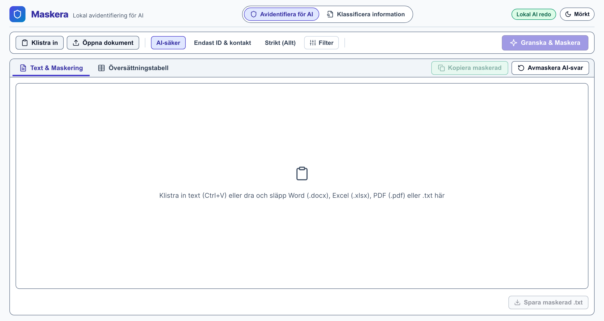
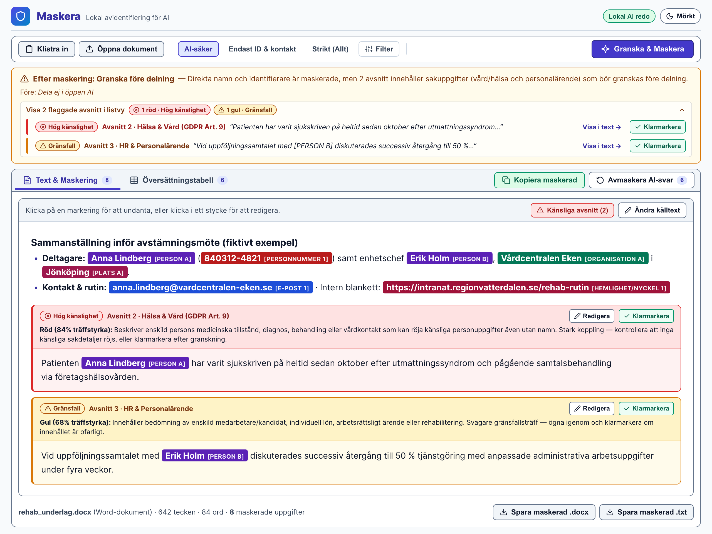
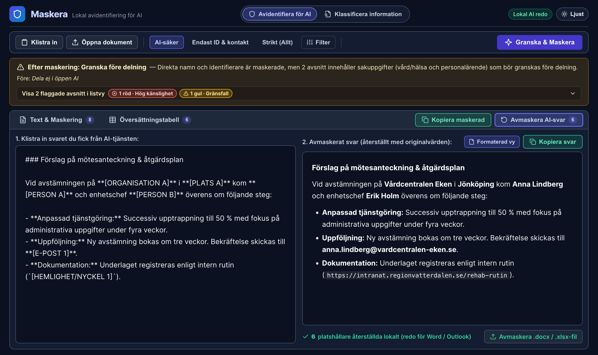

# Maskera

Maskera är ett snabbt, helt lokalt skrivbordsverktyg med **två fristående arbetslägen** i sidhuvudet:
1. **Avidentifiera för AI** — automatisk identifiering och maskering av personuppgifter (PII), tekniska hemligheter och känslig kontext i svenska texter, samt lokal återställning (avmaskering) av AI-svar.
2. **Klassificera information (Grön / Gul / Röd)** — fristående informationsklassning och hanteringsstöd för texter och dokument *utan att maskera texten*, uppdelat i två pedagogiska frågor: *1. Vad innehåller informationen?* och *2. Hur får vi hantera informationen?*

Allt körs **100 % lokalt** på din dator utan molnanrop.

---

## Gränssnitt & arbetsflöde

### 1. Ren startvy före granskning


### 2. Granska, maskera och kontrollera känsliga avsnitt (Ljust tema)


### 3. Återställ (avmaskera) AI-svar med dokumentformatering (Mörkt tema)


> **Interaktiv HTML-förhandsvisning:** Filen [`docs/screenshots/maskera-ui-demo.html`](docs/screenshots/maskera-ui-demo.html) är en fristående HTML-dump som använder applikationens faktiska stilmall (`src/index.css`) och kan öppnas direkt i en webbläsare (med `?view=setup`, `?view=empty`, `?view=mask`, `?view=table` eller `?view=unmask`) för att testa vyerna samt växla mellan **Ljust** och **Mörkt** tema.

---

## Vad gör det?

Klistra in text direkt från urklipp (`Ctrl+V` eller knappen **Klistra in**), skriv i editorn eller öppna/dra-och-släpp **Word (`.docx`, `.odt`), Excel (`.xlsx`, `.xls`, `.ods`), PDF (`.pdf`) eller textfiler (`.txt`, `.csv`, `.md`)**, välj snabbprofil och låt Maskera arbeta i tre lager:

1. **Lager 1 — Struktur & Hemligheter (< 1 ms):** Förkompilerade reguljära uttryck med Luhn- och datumvalidering identifierar personnummer, samordningsnummer, organisationsnummer, e-post, telefonnummer, IBAN/Bankgiro/Plusgiro, betalkort, 16–22-siffriga tjänstekort/SITHS-kort, HSA-ID, interna intranätlänkar (`https://intranat...`) samt API-nycklar/JWT/privata nycklar.
2. **Lager 2 — Namngivna entiteter (Svensk BERT NER via `ort`):** Identifierar personnamn, organisationer, platser, tider och händelser i kontext (~33× snabbare exekvering via statiskt länkad Microsoft ONNX Runtime med flertrådad SIMD och längdsorterad mini-batchning).
3. **Lager 3 — Semantisk AI-gatekeeper (`EmbeddingGemma 2`):** Analyserar dokumentets avsnitt semantiskt (768-dimensionella inbäddningar) och skiljer på bedömningen **Före** respektive **Efter maskering**:
   - Om risken låg i rena identifierare (t.ex. ett SITHS-kortnummer och en intranätlänk som nu är bortmaskerade) blir statusen grön (**Redo för AI**).
   - Om brödtexten innehåller sakuppgifter som kan innebära bakvägsidentifiering eller sekretess även utan namn markeras avsnittet med tydlig förklaring som **Röd (`Hög känslighet`)** eller **Gul (`Gränsfall`)** — med möjlighet att redigera på plats eller klicka **Klarmarkera** efter manuell kontroll:
     - **Hälsa & Vård (GDPR Art. 9)** — diagnoser, sjukskrivning, behandling, symtom, vårdjournaler.
     - **Känslig personuppgift / Lagöverträdelse (GDPR Art. 9–10)** — brottsmisstanke, dom, socialtjänst, LVU/LVM, facklig/politisk/religiös tillhörighet.
     - **Tjänstekort, eID, Behörighet & Intranät** — SITHS-kort, e-legitimation, certifikat, reserv-/konsultkort och interna behörighetsrutiner.
     - **Affärskritiskt & Företagshemligheter** — opublicerade siffror, M&A-bud, marginaler, kundofferter, avtalsvillkor.
     - **Säkerhet, IT-arkitektur & Intern kod** — sårbarheter, penetrationstester, brandväggsregler, intern infrastruktur.
     - **HR & Personalärende** — lönesättning, medarbetarsamtal, rehabilitering, arbetsrättsliga ärenden.
4. **Sömlös redigering, kopiering & avmaskering av AI-svar:**
   - **Undanta med 1 klick:** Klicka (eller tryck `Retur`/`Mellanslag`) på ett markerat ord för att avmaskera/undanta det — säkerhetsbedömningen uppdateras direkt (< 1 ms).
   - **Redigera utan att tappa maskeringar:** Klicka direkt i ett stycke (och klicka utanför för att spara) eller använd knappen **Ändra källtext** — befintliga maskeringar i övriga texten bevaras automatiskt.
   - **Kopiera & avmaskera formaterat:** Klicka **Kopiera maskerad**, skicka texten till valfri AI-tjänst och klistra in svaret under **Avmaskera AI-svar**. Svaret återställs lokalt med originalnamn och renderas som formaterad dokumenttext (utan råa `**`- och `###`-tecken) som kopieras med både rik formatering (för Word/Outlook/Teams) och ren text.
   - **Portabel dokumentexport & avmaskering (`.docx` / `.xlsx`):** Spara maskerade kopior av Word- och Excel-filer med bibehållen layout, stilar och formler (inklusive ord som Word delat över flera `<w:r><w:t>`-element), och återställ AI-bearbetade `.docx`/`.xlsx`-filer via **Avmaskera .docx / .xlsx-fil** helt utan installerat Office-paket.

---

## Fristående läge: Klassificera information (Grön / Gul / Röd)

När du bara vill få hjälp att bedöma ett dokuments skyddsnivå inför lagring eller delning — utan att byta ut namn mot `[PERSON A]` — växlar du till **Klassificera information** i sidhuvudet. Läget bygger på en egen fristående Rust-modul ([`src-tauri/src/info_classification.rs`](src-tauri/src/info_classification.rs)) med ren JSON-datamodell, förberedd för att i ett senare skede kunna köras som ett separat system eller central servertjänst:

1. **Fråga 1 — Vad innehåller informationen?**
   - **GRÖN — Information som kan delas öppet:** Publicerade broschyrer, tidtabeller, offentliga verksamhetsbeskrivningar och öppet informationsmaterial utan interna utkastmarkeringar eller skyddsvärda uppgifter (publika funktionsmejladresser som `info@`/`kundtjanst@` och servicenummer som `1177`/`0771` ger inte falskt utslag).
   - **GUL — Information som vi behöver vara försiktiga med:** Intern arbetsinformation som inte ska spridas fritt, men som kan delas med rätt kollegor — t.ex. vanliga APT- och mötesanteckningar, utkast till broschyrer, intern bemannings- och verksamhetsplanering, interna rutiner, intranätlänkar samt personkopplade kontaktuppgifter.
   - **RÖD — Information som kräver särskilt skydd:** Uppgifter som kan orsaka skada för individ, verksamhet eller organisation — patient- och vårduppgifter, skyddade personuppgifter/socialtjänst/lagöverträdelser, sekretessbelagda upphandlingsuppgifter och affärshemligheter, **känsliga personalärenden (HR)** (rehabilitering, disciplinärenden, individlön), säkerhetssystem/sårbarheter, personnummer, SITHS-/kortnummer och kryptonycklar.
2. **Fråga 2 — Hur får vi hantera informationen?**
   - Visar pedagogisk vägledning för **lagring** och **delning** utifrån dokumentets färg (med tydlig påminnelse om att bedömningen är ett lokalt beslutsstöd som alltid stäms av mot verksamhetens fastställda riktlinjer).
   - Dokumentet visas helt **omaskerat** nedanför med eventuella gula och röda avsnitt tydligt utmärkta och förklarade.

---

### Vad detekteras?

| Kategori | Lager / Metod | Exempel |
|---|---|---|
| Hemlighet/Nyckel | Lager 1 (Regex) | API-nycklar (`sk-...`, `AIza...`, `ghp_...`, `AKIA...`), JWT, PEM-nycklar, HSA-ID (`SE...`), intranät-URL:er (`https://intranat...`) |
| Personnummer | Lager 1 (Regex + datum) | `850515-1234`, `19850515-1234`, `701063-2391` (samordningsnummer) |
| Organisationsnummer | Lager 1 (Regex) | `556614-5180` (skiljs automatiskt från personnummer via månadsfält >= 20) |
| Kortnummer | Lager 1 (Regex + Luhn / SITHS) | Betalkort (`4532-...` med Luhn) samt 16–22-siffriga tjänste-/SITHS-kort (`9752267235710527661`) |
| E-postadress | Lager 1 (Regex) | `namn@example.se` |
| Telefonnummer | Lager 1 (Regex) | `+46 8 123 45 67`, `08-123 45 67` |
| Konto/Giro | Lager 1 (Regex) | IBAN `SE9550000000054910000003`, Bankgiro `5402-1234`, Plusgiro `12345-6` |
| IP-adress | Lager 1 (Regex) | Publika IPv4-adresser (privata nät `10.x`, `192.168.x`, `127.x` filtreras bort) |
| Person | Lager 2 (BERT NER) | `Anna Lindberg` |
| Organisation | Lager 2 (BERT NER) | `Försäkringskassan`, `Vårdcentralen Eken` |
| Plats | Lager 2 (BERT NER) | `Stockholm`, `Jönköping` |
| Övrigt | Lager 2 (BERT NER) | Diverse namngivna entiteter |
| Tid | Lager 2 (BERT NER) | `idag`, `2027-01-04` |
| Händelse | Lager 2 (BERT NER) | Namngivna händelser |
| Känsliga avsnitt (Röd / Gul) | Lager 3 (`EmbeddingGemma 2`) | Vård/hälsa, lagöverträdelser, SITHS/eID/intranät, företagshemligheter, IT-säkerhet, HR |

---

## Finjustera och "träna" EmbeddingGemma 2 med egna textexempel

Till skillnad från klassiska AI-modeller som kräver tung omträning av neurala vikter på GPU fungerar Lager 3 (`EmbeddingGemma 2` i [`src-tauri/src/classifier.rs`](src-tauri/src/classifier.rs)) som en **ankarbaserad inbäddningsklassificerare (Few-Shot Prototype Classifier)**.

Vid programstart omvandlas alla referensexempel (`task: classification | query: ...`) till L2-normaliserade 768-dimensionella vektorer på några tiotals millisekunder. När ett dokument granskas jämförs varje avsnitts vektor mot både känsliga ankare (`best_sim`) och neutrala ankare (`neutral_best`), där marginalen `margin = best_sim - neutral_best` avgör om avsnittet är grönt, gult eller rött.

Det innebär att modellen löpande kan **"tränas" och finjusteras för en specifik verksamhet** genom att helt enkelt injicera fler textexempel i tre grupper:

1. **Röda textexempel (`severity: "high"` i `PROTOTYPE_GROUPS`):**
   - Konkreta exempel på avsnitt med hög sekretess eller risk för bakvägsidentifiering (t.ex. branschspecifika patient-/utredningsformuleringar, konfidentiella anbudstexter eller sårbarhetsrapporter) som ska flaggas med **Hög känslighet (Röd)**.
2. **Gula textexempel (`severity: "medium"` i `PROTOTYPE_GROUPS`):**
   - Exempel på gränsfall där texten inte nödvändigtvis är blockerad efter maskering, men där användaren bör få en **Gränsfall-markering (Gul)** för att kontrollera kontexten innan delning (t.ex. HR-/rehabiliteringsanteckningar, interna arbetsutkast eller styrande rutiner).
3. **Gröna / neutrala motexempel (`NEUTRAL_PROMPTS`):**
   - Exempel på ofarlig vardags- och verksamhetstext som innehåller domänord men **inte** ska falskflaggas — exempelvis APT- och mötesmallar, övergripande bemanningsplanering eller automatiska varningsrader för extern e-post i Outlook/Exchange.

### Förberett för lokal verksamhetsanpassning
Eftersom inbäddningarna beräknas dynamiskt i `EmbeddingClassifier::load` kan denna mekanism i framtida versioner enkelt exponeras som:
- En **lokal JSON-/konfigurationsfil** (t.ex. `organisationens_exempel.json`) som administratörer kan distribuera tillsammans med `Maskera-portabel.exe` för att skräddarsy röda, gula och gröna exempel för kommun, region eller företag.
- Direkt återkoppling i gränssnittet (t.ex. *" spara liknande formulering som Gult gränsfall / Grönt undantag"*), där allt sparas lokalt på användarens dator utan att någon text någonsin skickas till molnet.

---

## Tillgänglighet (WCAG 2.2 AA) & Tema

- **Ljust och mörkt tema:** Följer operativsystemets färgschema (`color-scheme: light dark` och CSS `light-dark()`) som standard, med möjlighet att växla direkt i sidhuvudet (**Ljust** / **Mörkt**) eller välja **System / Ljust / Mörkt** under **Filter** utan vit blinkning (FOUC) vid uppstart.
- **Kontraster & icke-färgberoende indikatorer (WCAG 1.4.1, 1.4.3 & 1.4.11):** Alla textfärger och kategorietiketter håller minst `4.5:1` kontrast, inmatningsfält och interaktiva ramar håller minst `3:1`, och röda/gula risknivåer kommuniceras alltid med **både ikon, textetikett (`Hög känslighet` / `Gränsfall`) och ram** — samt stöd för `@media (prefers-contrast: more)` och Windows High Contrast (`@media (forced-colors: active)`).
- **Full tangentbordsnavigering:** Stöd för piltangentsnavigering i verktygsrad och dokumentflikar (`focusgroup`), tydliga `:focus-visible`-ramar, unika skärmläsarnamn per avsnitt samt tangentbordsstyrning (`Retur`/`Mellanslag`/`Esc`) för både ordmarkeringar och styckeredigering.

---

## Hur fungerar arkitekturen?

```
Tauri 2-app (Rust-shell + WebView)
  └── React 19-gränssnitt (TypeScript, WCAG AA, Ljust/Mörkt tema)
        └── Tauri-kommandon (invoke + live-events)
              ├── Lager 1: Förkompilerad Rust Regex-motor (< 1 ms)
              ├── Lager 2: KBLab/bert-base-swedish-cased-ner via Microsoft ONNX Runtime (`ort`)
              ├── Lager 3: EmbeddingGemma 2 (768d q4 ONNX) ankarbaserad kontextklassificerare
              └── Dokumentmotor: Portabel läsning & formateringsbevarande export (.docx, .xlsx, .pdf, .odt, .ods)
```

### Modeller & lokal lagring (engångsnedladdning eller offline-mapp)

Vid **första starten** kontrollerar Maskera om båda AI-modellerna finns lokalt. Om någon saknas visas en **välkomst- och installationsvy med gemensam förloppsindikator (`<progress>`)** som laddar ner och initierar båda modellerna i ett svep (~318 MB totalt). Vid alla efterföljande starter öppnas editorn direkt utan väntetid:

- **Lager 2 (Svensk BERT NER, ~121 MB):** [`psvensk/bert-base-swedish-cased-ner-onnx`](https://huggingface.co/psvensk/bert-base-swedish-cased-ner-onnx)
- **Lager 3 (EmbeddingGemma 2, ~197 MB):** [`onnx-community/embeddinggemma-300m-ONNX`](https://huggingface.co/onnx-community/embeddinggemma-300m-ONNX) (`model_q4.onnx`)
- **Portabel / offline-installation:** Modellerna cachas i användarens lokala appdata-mapp, men kan även läggas i en `models/`-mapp bredvid `Maskera-portabel.exe` eller väljas från valfri mapp/USB-sticka via knappen **Välj lokal modellmapp…** om datorn saknar internetåtkomst.

---

## Köra lokalt (källkod)

```bash
npm install
npm run tauri dev
```

## Bygga fristående app

```bash
# Kontrollera frontend + Rust-tester
npm run build
cargo test --manifest-path src-tauri/Cargo.toml

# Kalibrera & verifiera EmbeddingGemma 2-ankare mot testexempel
cargo test --manifest-path src-tauri/Cargo.toml calibrate_embeddinggemma2 -- --ignored --nocapture

# Bygg release-paket
npm run tauri build
```

Vid push till `main` bygger GitHub Actions automatiskt både:
1. **`Maskera-portabel.exe`** — en fristående fil som kan köras direkt utan installation eller administratörsrättigheter.
2. **`Maskera-installation`** — vanlig Windows NSIS-installerare (`*-setup.exe`).
